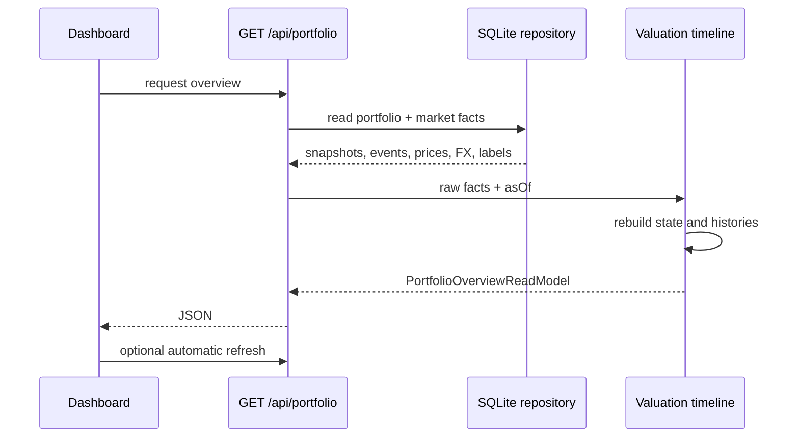
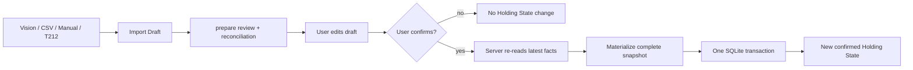
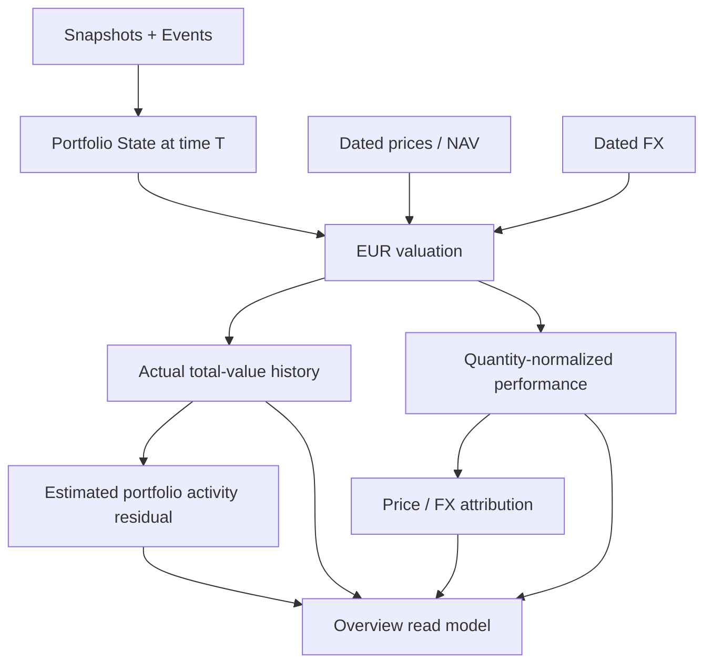
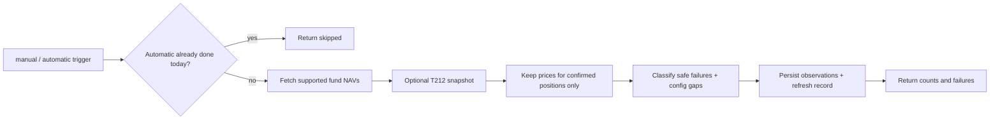
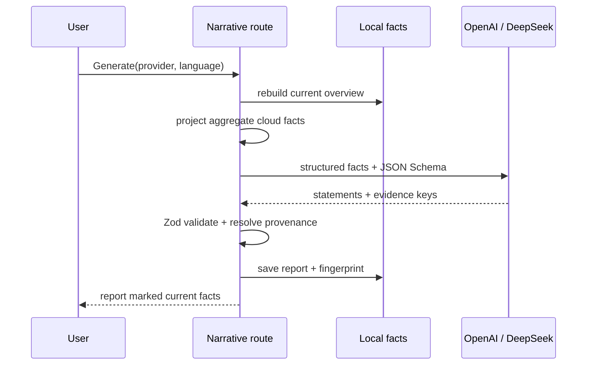

# Invest Assets Monitor：架构与实现说明

本文描述当前代码的真实实现，目标是让项目所有者能够理解数据如何进入系统、如何保存、如何计算，以及前端为什么会显示某个结果。文中示例均为抽象示例，不包含真实持仓、截图、数据库或密钥。

如果只想快速重新建立项目心智模型，先记住四句话：

1. Import Draft 是待审核的建议，不是持仓事实。
2. 用户确认后产生 Holding State Snapshot；价格刷新永远不能改 Holding State。
3. 首页不是直接查 SQL，而是由 valuation timeline 从 snapshots、events、prices 和 FX 重建 read model。
4. 云端 AI 只能在明确触发时处理图片或有限聚合事实，不能绕过本地校验和确认门。

## 1. 产品边界

这是一个本地优先、单用户的投资监控应用：

- 聚合多个 Source Account 的基金、ETF、股票、债券与账户内现金。
- 保留资产原币种，同时以 EUR 计算组合总值。
- 区分“持有什么”和“这些资产现在值多少”。
- 截图、CSV、手工输入和 Trading 212 都先产生 Import Draft；用户确认前不会改变持仓。
- 应用只监控和展示，不下单，也不提供投资建议。

最重要的设计原则是：**Holding State 与 Market Data 分开**。数量、成本和账户内现金属于持仓事实；NAV、证券价格和汇率属于市场观察。刷新价格不能修改数量或成本。

## 2. 总体分层

```text
Browser / React
  ├─ Portfolio overview + holding drawer
  ├─ Import review + confirmation
  └─ Source Account management
             │ HTTP / JSON
             ▼
Next.js route handlers
  ├─ validate request
  ├─ call application/domain modules
  └─ translate errors into HTTP responses
             │
             ▼
Application modules
  ├─ import parsing + pure review editor
  ├─ valuation timeline deep interface
  ├─ market refresh coordinator
  └─ dashboard/source-account read models
             │
             ▼
Domain modules
  ├─ Import Draft and reconciliation rules
  ├─ snapshot/event → current Portfolio State
  ├─ identity matching
  └─ EUR valuation
             │
             ▼
Infrastructure adapters
  ├─ SQLite repository
  ├─ OpenAI vision extractor
  ├─ Trading 212 read-only client
  ├─ Eastmoney fund NAV client
  ├─ Danske Invest fund NAV client
  └─ ECB FX client
```

目录含义：

- `src/domain/`：不依赖 React、Next.js 或 SQLite 的业务规则。
- `src/application/`：把领域事实组织成具体用例和前端 read model。
- `src/infrastructure/`：外部系统与持久化适配器。
- `src/app/api/`：很薄的 HTTP seam，负责输入校验和响应。
- `src/components/`：客户端交互与展示。
- `tests/`：按照 domain、application、infrastructure、integration 四层验证。

正常依赖方向是 `app/components → application → domain`；infrastructure 实现 application/domain 所需的外部能力，route 在 composition root 把它们连接起来。Domain 不知道 React、HTTP、provider 或 SQLite。Application 可以组合 domain 与抽象输入，但不读取环境变量。只有 server/route 和 infrastructure 接触进程配置、网络和文件数据库。

当前最重要的五个 deep interface：

| Interface | 输入 | 输出 | 隐藏的复杂度 |
| --- | --- | --- | --- |
| `createPortfolioValuationTimeline` | snapshots、events、prices、FX、labels、asOf | 完整 overview read model | state 重建、当前估值、历史估值、period、allocation、FX overview |
| `createMarketDataRefresh` | repository 能力、NAV provider、可选 T212 snapshot | refresh outcome | 每日 gate、provider 聚合、Market Data-only 过滤、持久化、并发串行化 |
| `applyImportDraftEdit` | draft + 一个编辑意图 | 新 draft | 不可变 portfolio 更新、holding 字段规范化、reconciliation 重算 |
| `createPortfolioAnalystContext` | overview read model + 一个批准的 analyst job | versioned evidence bundle | job-specific 事实选择、排序、脱敏、Evidence Key、限制与 32 KiB guard |
| `validatePortfolioAnalystAnswer` | Analyst Context + 不可信 candidate output | validated answer | strict shape、Evidence Key membership、Facts As Of、limitations 与 allowed action 校验 |

## 3. 三类核心数据

### 3.1 Import Draft：尚未确认的输入

相关类型位于 `src/domain/import-draft.ts`；`src/domain/imports.ts` 保留为兼容导入入口。

Import Draft 保存 Vision、CSV、API 或手工输入的解释结果。每个字段都是 `DraftValue<T>`：

- `known`：来源明确，例如 Vision、CSV 或 API。
- `inferred`：系统根据其他字段推算，同时保留推算原因。
- `unknown`：必须由用户补充，不能直接 materialize 成持仓事实。

这样做的原因是：图片识别不完整时不能用空字符串或零值伪装成真实数据。

Import Draft 包含：

- Source Account
- 来源类型
- 截止时间
- 待确认 holdings
- 可选 Portfolio Cash
- warnings
- reconciliation 结果

Draft 保存到 SQLite，但不会参与首页估值。只有 `confirmImport` 成功后才会生成 Confirmed Import 和 Holding State Snapshot。

### 3.2 Holding State：确认后“持有什么”

相关类型位于 `src/domain/portfolio/types.ts`，重建逻辑位于 `src/domain/portfolio/ledger.ts`。

Holding State 包含：

- `Position.quantity`
- `Position.costBasis`
- `Position.reportedPriorReturn`
- 可选资产元数据和最后一次来源价格
- Source Account 内的 Portfolio Cash

系统不直接把 current state 当作唯一事实保存。SQLite 保存按时间排列的 snapshots；`buildPortfolioState` 读取每个 Source Account 最新 snapshot，再应用 snapshot 之后的 Portfolio Events，重建当前状态。

目前 Portfolio Event 的领域模型只实现了 sale。数据库已经有 event 表，但前端尚未提供完整的买入、分红、费用和转账事件录入流程。

### 3.3 Market Data：价格与汇率观察

相关类型位于 `src/domain/market-data.ts`。

Market Data 独立存储：

- `MarketPriceObservation`：按 Source Account + instrument + 日期 + source 标识的价格/NAV。
- `FxRateObservation`：某一日期一单位原币等于多少 EUR。
- `MarketRefreshRecord`：一次批量刷新的 manual/automatic trigger、provider、完成时间、成功、未变化和失败统计，以及稳定 category code 与经过安全归类的失败摘要。

价格观察包含两个不同时间：

- `asOf`：价格或 NAV 属于哪一个市场日期。
- `recordedAt`：本应用什么时候拿到这条数据。

这一区分对 QDII 很重要：7 月 24 日打开应用时，最新可用 NAV 可能仍属于 7 月 23 日，而这条 NAV 可能到 7 月 24 日或 25 日才被发布和记录。

## 4. 时间字段的含义

项目里容易混淆的时间有四种：

| 字段 | 含义 |
| --- | --- |
| snapshot `asOf` | Source Account 的 Holding State 在什么时候有效 |
| price/NAV `asOf` | 价格属于哪个市场日期 |
| `recordedAt` | 应用什么时候获得该市场数据 |
| `confirmedAt` | 用户什么时候确认 Import Draft |

不能用 `recordedAt` 代替 NAV 日期，也不能因为 NAV 晚一天发布就把它当成当天的新自然日价格。

`marketDataTimelineTime` 将“日期型市场观察”放在该 UTC 日期的日末，并限制在当前查询时间以内。Holding history 和 portfolio history 共用这个函数，避免两套日末规则逐渐不一致。

## 5. 导入工作模式

### 5.1 账户截图

调用链：

```text
1–6 complementary PNG/JPEG/WebP images
  → POST /api/imports/analyze
  → one OpenAI Responses API multi-image input
  → strict structured output
  → ScreenshotExtraction
  → prepareScreenshotImport
  → Import Draft
  → user review
  → POST /api/imports/:id/confirm
  → confirmed Holding State Snapshot
```

关键文件：

- `src/infrastructure/openai/openai-vision-extractor.ts`
- `src/application/imports/vision-extraction-contract.ts`
- `src/application/imports/vision-position-merge.ts`
- `src/application/imports/screenshot-import-preparation.ts`
- `src/app/api/imports/analyze/route.ts`

隐私边界：

- OpenAI API key 只从服务端环境变量读取。
- 原图和 provider response 不写入本地数据库。
- OpenAI 是云端处理方，因此用户仍需接受图片离开本机这一事实。
- Vision 结果必须进入 review，不能直接更新 portfolio。

同一次 import 最多包含 6 张、每张不超过 10 MB、合计不超过 30 MB。模型把账户 overview、holding rows 与 fund detail 当成同一组证据，通过名称和 ISIN 合并；同一基金出现在多张图中时只能生成一个 position。结构化结果包含可见的 units、market value、prior return、NAV、NAV date、ISIN 和 asset type，并在 review 前检查 `quantity × NAV ≈ market value` 等可核对关系。限制必须在创建 extractor 前验证，避免错误选择产生云端费用。

截图被定义为 **detected-holdings update**：

- review 只展示本次截图实际识别出的基金。
- 数据库中同一 Source Account 的其他已确认持仓不会被追加到 review。
- 确认时，repository 会在 transaction 前把本次更新与最新 confirmed state 合并；截图未涉及的持仓自动保持不变。
- 因此“一张单基金截图”既不会在 review 中冒出其他基金，也不会在确认后删除其他基金。

### 5.2 CSV 与手工输入

CSV parser 会验证：

- 必需列
- Source Account 是否匹配
- instrument code 是否重复
- quantity × NAV 是否等于 current value
- cost basis + prior return 是否等于 current value

CSV 和 manual 仍沿用原有 partial-review 模式：既有持仓会进入完整 review，允许用户明确移除不再持有的项目。这个行为与单基金截图不同，是为了保持当前已实现的 CSV 管理能力。

### 5.3 Trading 212

Trading 212 adapter 只调用：

- `GET /equity/account/summary`
- `GET /equity/positions`

API response 被转换成一个完整 account snapshot，然后与最新 Holding State reconciliation：

- quantity、Cost Basis、cash 都没变：只保存 Market Data，不打开 review。
- 有持仓变化：生成 Import Draft。
- API 中新增：`new`。
- 数量或成本变化：`holding-changed`。
- 旧持仓在完整 API snapshot 中缺失：`possibly-removed`。
- 用户修正过的 ETF/asset type 和 Reported Prior Return 不会被下一次 sync 覆盖。

当同一次完整 snapshot 包含新 holding 或 cash change 时，既有的 price-only holding 仍会随 draft 一起 materialize，以免完整 snapshot 丢失它们。它们的 `Reported Prior Return` 是开始监控时冻结的历史事实，而 `reportedMarketValue` 是最新值，因此两者在后续价格变化后不再满足 `costBasis + reportedPriorReturn = reportedMarketValue`。Confirm route 仍校验每行 `quantity × price`，并继续对新 holding 执行完整 accounting 校验，但不会用首次导入等式拒绝已经跟踪的 Trading 212 holding。

## 6. Snapshot、reconciliation 与确认

`prepareImportDraftForReview` 负责把新 draft 与 current Portfolio State 比较。匹配身份使用：

- Source Account
- instrument id
- instrument code/ISIN/ticker
- 大小写归一化

`reconcileImportDraft` 只把 quantity、Cost Basis 和 currency 的改变算作 Holding State change；NAV、market value 或 price date 的变化属于 `market-data-updated`。

确认时：

1. HTTP route 用 Zod 校验可编辑值。
2. `applyImportDraftReview` 保留未被用户修改字段的原始来源信息。
3. repository 再次读取最新 facts，避免使用过时 current state。
4. screenshot draft 通过 `materializeConfirmedImportSnapshot` 自动补齐未被截图覆盖的既有持仓。
5. 在一个 SQLite transaction 中更新 draft、插入 Confirmed Import、插入 snapshot 并标记 confirmed。

用户重复确认同一个 draft 时，repository 返回已经确认的记录，不重复写入。

## 7. 当前估值

当前估值路径：

```text
latest confirmed Portfolio State
  + latest applicable price per holding
  + latest FX per currency
  → valuePortfolio
  → createPortfolioValuationTimeline
  → createPortfolioOverviewReadModel adds insights
  → PortfolioOverviewReadModel
```

Route 不再先计算一个 `state` 再连同 snapshots 一起传入。`createPortfolioValuationTimeline` 只接受原始 facts，并在内部唯一地调用 `buildPortfolioState`；这消除了“caller 传入的 current state 与历史 snapshots 不一致”的无效状态。它随后统一组装 current dashboard、portfolio history、holding history、period combination、account allocation 和 FX overview。较小的 history 模块仍然保留为内部可测试 seam，但 route 只需要知道这一个高层入口。

`valuePortfolio` 位于 `src/domain/portfolio/valuation.ts`：

- 原币价值优先使用来源报告的 `reportedMarketValue`，避免 quantity × rounded NAV 的小数误差。
- 否则使用 `quantity × unit price`。
- EUR value = original value × `eurPerUnit`。
- Portfolio Cash 只乘 FX，不需要证券价格。
- 缺少价格或 FX 的持仓进入 `missingInputs`，不会伪造估值。
- 价格匹配包含 Source Account，防止两个账户拥有相同 instrument id 时误用另一账户的价格。

## 8. Today、7 days 与 30 days

### 8.1 Today 的真实语义

对于异步市场，所有 holding 不一定拥有相同的最新价格日期。因此 Today 采用：

> 每个 holding 的最新可用日变化，再把这些 holding changes 聚合成 portfolio Today。

对一个已有至少两个价格点的 holding：

1. `current` 使用最新价格/NAV和当前可用 FX。
2. baseline 优先选择最近一个 `priceAsOf` 不同的价格/NAV；baseline FX 使用 current 之前最近一次 valuation 的汇率。这样既包含最新 NAV 日变化，也不会因为 NAV 延迟而把多天汇率变化重复算入 Today。
3. 如果只有一个价格点，则允许用前一个 valuation point 计算 FX-only change。
4. baseline 与 current 距离超过四天时，Today 不可用，避免把很旧的数据冒充日变化。

QDII 示例：

```text
7/24 查看组合
最新 QDII NAV：7/23
上一份 QDII NAV：7/22
最新 EUR/CNY：可到 7/24

Today = 7/23 NAV 相对 7/22 NAV 的价格影响
      + 当前汇率相对前一次 valuation 汇率的 FX 影响
```

所以 QDII 不会因为 NAV 比欧美市场慢一天就只显示汇率变化。holding 行仍显示实际使用的 NAV 日期，让用户能看出数据滞后。

价格与汇率分解：

```text
priceChange = quantity × (currentPrice - baselinePrice) × baselineFx
fxChange    = quantity × currentPrice × (currentFx - baselineFx)
totalChange = priceChange + fxChange
```

`combinePortfolioPeriodHistory` 强制顶部 Today change 等于所有 available holding Today changes 的总和，并产生 `[baseline total, current total]` 两点组合曲线。这样顶部数字和每行数字不会再由两套 Today 口径计算。

### 8.2 7 days 与 30 days

较长区间使用 `selectRangeBaseline`：

- 7 days 目标 baseline 允许最多三天容差。
- 30 days 目标 baseline 允许最多七天容差。
- 如果监控本身晚于目标日期，则使用最早真实 observation，并标记 `coverage: partial`。
- 如果已有很长历史但目标附近没有可信点，则保持 unavailable。

Portfolio history 会重建每个历史时间点的 state，并同时保留两种明确分开的序列：performance points 把历史 value 归一到当前 quantity，避免把新增份额或新持仓错误当成投资收益；value history 则保留每个日期实际持有的总资产，因此会如实反映入金、出金、买卖和新增账户。相邻日期的 quantity 会产生事实性的 added、increased、reduced 或 exited 标记，即使现金买入使总资产几乎不变，也能标出实际的持仓变化日期。每天的 `portfolioActivityEur` 则是 actual value change 减去 capital-flow-adjusted investment change 的残差；它是可审计的推算值，但并不擅自断言残差一定是哪一种交易。如果区间内有持仓已完全退出，由于当前 snapshot 无法还原已实现收益，activity breakdown 保持 unavailable，但仍保留事实性的 exited 标记，而不把卖出回款误判为外部入金。

## 9. 前端 read model 与 UI

`src/application/portfolio-read-model.ts` 是前端主要 interface。React 不直接读取领域 snapshot 或 SQLite row。

首页拿到：

- total EUR value
- holding display fields
- original-currency value
- calculated total return
- Today/7-day/30-day performance
- actual total-value history for the same periods
- price/FX attribution
- price history
- source-account status
- market refresh status
- EUR/CNY overview
- locally calculated Portfolio insights：集中度、持仓计价币种/资产类别分布、近期贡献和数据质量

`src/application/portfolio-insights.ts` 只消费已经估值完成的 `PortfolioOverviewReadModel`，不读取 SQLite、截图或 provider credentials。这里的 holding currency 是证券计价币种，不代表基金底层资产的 look-through currency exposure。它生成稳定的结构化事实，首页与可选 LLM narrative 共用这个边界；LLM 不能自行重新计算收益或读取原始 portfolio records。

`src/application/portfolio-narrative-facts.ts` 再把 insights 投影成有限的 cloud facts 和 provenance catalogue。发送给 provider 的每组事实都有 server-defined `factKey`；模型的 headline、overview、每条 observation 和 data-quality note 都必须返回受 schema 限制的 evidence keys。服务端过滤这些 keys，再保存对应的本地事实摘要，因此 UI 展示的是可校验映射，而不是模型自行编造的“引用”。

`src/application/portfolio-analyst-context.ts` 是下一代 Analyst 的确定性事实边界。目前提供 `readPeriodDrivers` 和 `readDataQuality` 两个只读工具：前者只输出指定区间的组合变化、Price/FX effect、estimated portfolio activity 和最多三个主要 holding contributor；后者输出 freshness/coverage 汇总、按影响排序的 Data Gap、最多三次安全 refresh 摘要和最多一个可提议但不会执行的 Factual Update。两者不读取 SQLite、不调用 provider，也不执行刷新。

工具输出固定为 `portfolio-analyst-context.v1`，每条事实由应用分配 context-local Evidence Key、label 和 provenance。Read model 单独保留只有用户明确提供时才存在的 `analystDisplayName`，因此 dashboard 为显示而使用的 instrument-id fallback 不会跨过 Analyst seam；missing-input facts 也会在 application 层解析成这个安全名称。内部 holding/account id、symbol/ISIN、quantity、Cost Basis、原始 provider error 和数据库行不会进入这两个初始 job；holding display name 最多三个且可由用户关闭。序列化结果超过 32 KiB 会在本地失败，不能继续进入 cloud seam。这里的 tool 是可靠的应用能力，不等于让 LLM 自主选择工具；R 中仍由显式 job 直接调用对应 tool，model-controlled tool loop 留给 S。

`src/application/portfolio-analyst-answer.ts` 定义模型输出的第二道边界。JSON Schema 只能约束字段、类型和数量；`validatePortfolioAnalystAnswer` 还会用本次 Context 做运行时语义校验：Evidence Key 必须真实存在且单个 claim 内不重复，`factsAsOf` 必须完全一致，limitations 必须逐项复制，proposed update 必须为 `null` 或命中 server-owned `allowedActions`。因此模型即使返回语法正确的 JSON，也不能引用另一次请求的证据、隐藏 Context 限制或发明一个更新动作。该 application 模块本身不调用 provider，也不保存或展示回答。

`GET/POST/DELETE /api/portfolio/analyst` 是当前的 on-demand conversation boundary。浏览器只能提交 conversation id、当前问题、provider、默认 period、language 与 holding-name preference；不能提交 PortfolioOverview 或自造 Context。每个 POST 都从本地 ledger 和 Market Data 重建最新 overview。S 的 production runtime 由 Pi Agent 和 `pi-ai` 直接连接配置的 OpenAI/DeepSeek provider：第一 model turn 只能从 `read_period_drivers` 与 `read_data_quality` allowlist 选择一个工具，application-owned tool 执行后，第二 model turn 才能基于当轮 fresh Context 回答。单轮 tool budget 当前固定为一，第二个调用会在 Pi preflight 被阻止且不能读取 portfolio facts。R 的 provider adapter 路径只保留给未注入 agent runtime 的测试与兼容调用。OpenAI 的 Pi transport 设置 `store: false`/无 prompt cache，最终模型回合使用 strict JSON Schema；DeepSeek 使用 JSON object mode；两者随后仍执行同一个本地 semantic Evidence validation。

浏览器请求 `application/x-ndjson` 时，API 依次发送 accepted、选择工具、`tool-activity` started/completed、生成回答、answer delta 和 completed/failed 事件。activity 只包含 tool name、bounded input、facts timestamp 与 Evidence 数量，不包含原始 Portfolio Context。流中文字只是 provisional projection，服务端只在 schema 与 current-turn Evidence validation 都通过后保存 turn 和发出 completed。成功 report 的 `agentAudit` 保存 runtime、model-turn count、stop reason、bounded tool input、facts timestamp、Evidence Keys 与 blocked call，不保存 prompt、quantity、Cost Basis、内部 holding id 或 provider error。失败、中止或截断会丢弃 partial answer；durable failed-run audit 是 S 后续 slice。未请求流式内容的旧 JSON API 仍保留给兼容调用和测试。

`src/components/portfolio-analyst.tsx` 是这条边界的显式 sidecar UI。关闭时只有悬浮 Agent control；打开后桌面端固定在收窄的 app icon rail 右侧并让右侧 portfolio workspace 自适应宽度，小屏幕则成为 full-width sheet。低频 conversation settings 默认折叠，让历史与 composer 占主要空间。发送时 UI 立即建立右侧 user message；左侧 activity timeline 按事件追加选择工具、调用、bounded result summary 与生成/验证状态，随后才显示独立的流式 assistant message。completed event 用完整已验证的同一段 `answer.text` 原子替换 provisional text，因此完成态不再从“对话”变成“事实报告”。Claims、classification 与 cited Evidence Facts 统一收在回答下方默认关闭的“事实与依据”附件里；activity 不嵌在回答或该附件中。页面加载只读取 provider 配置和最近一次本地 conversation；真正的 Context 构建与 cloud request 只在用户发送消息后发生。浏览器以 `mode: agent` 发送自然语言问题和默认 period，而不是预先指定 domain job；Pi 根据问题选择批准的只读工具。默认 period 可随问题改变，provider、language 和 holding-name permission 在有 turn 后锁定，避免旧的带名称回答被较严格的新 privacy setting 继续带入 history。用户可以停止当前请求，或显式 Reset & delete 后开始新 conversation。

`src/application/portfolio-analyst-conversation.ts` 定义本地 conversation aggregate。SQLite 最多保存最近十二个完整 turn；发给 provider 的 history 只投影最近三个 turn pair，而且 assistant history 只含主回答文本和原始 `factsAsOf`，不含旧 Evidence payload。Prompt 明确规定历史文本只用于理解“它”“刚才的 FX”等指代，不能支持本轮 claim。本轮所有财务主张必须引用本轮刚重建的 Context，因此对话连续性与事实新鲜度是两条分开的责任链。

浏览器生成请求只包含 provider 和 language，不上传一份可自行修改的 insights。Narrative route 会通过 `createPortfolioOverviewReadModel` 从当前 SQLite ledger 与 Market Data 重建 insights；portfolio overview route 也复用同一 application seam。因此旧标签页不能把过时或任意构造的 aggregate facts 保存成 current report。

Narrative fingerprint 覆盖所有会影响报告内容的 aggregate facts，但忽略单纯的 dashboard request time。相同事实重新加载页面时报告仍标为 current；持仓构成、配置比例、performance 或 data-quality 改变后，旧报告保留并标为 previous facts。

`src/components/dashboard.tsx` 负责：

- period 和 Source Account 过滤
- Total value 折线、portfolio-activity 标记与 Daily change 可选日期柱形图切换；Today 不渲染无意义的单柱图
- compact ledger、market-price 与 ECB FX 状态
- holding detail drawer
- 手工 dated price 输入
- NAV refresh
- demo/local data 隔离

Account allocation 不在 overview 占据主卡，而是在 `src/components/source-accounts-panel.tsx` 中按稳定的 `sourceAccountId` 汇总本地已估值持仓。显示名称仍可重命名，但不会因此合并两个不同账户。

小图先把每只 holding 转换成相对自身 baseline 的百分比变化，再使用同一 Y 轴范围，因此不同规模的基金可以视觉比较。

`src/components/screenshot-import.tsx` 负责：

- 选择 Source Account 和输入方式
- 上传与图片分析进度
- editable draft
- reconciliation 状态
- confirmation

它不再自行实现 holding/cash reconciliation reducer。所有 add/remove/update/cash edit 都转换成一个明确的 edit intent，交给 `src/application/imports/import-review-editor.ts` 的纯函数处理。该 reducer 把字段规范化委托给 `import-review-holding-editor.ts`，把 Decimal 比较、Holding State 分类和计数委托给 `import-edit-reconciliation.ts`。这样 React 只管理交互；display name 或 market-price 字段变化不会被误报成 quantity/Cost Basis 变化。

前端没有权限绕过 confirmation；真正写入 snapshot 的 gate 在服务端 repository。

## 10. SQLite 持久化

默认文件是 `data/invest-assets-monitor.sqlite`，可通过 `PORTFOLIO_DB_FILENAME` 改变 basename。整个数据库被 Git 忽略。

| 表 | 作用 |
| --- | --- |
| `schema_metadata` | 当前 schema version |
| `import_drafts` | 可编辑 draft 和状态 |
| `confirmed_imports` | confirmation audit record |
| `opening_snapshots` | opening/holding-state snapshot JSON |
| `portfolio_events` | 已确认经济事件；当前主要预留给 sale/event 扩展 |
| `market_price_observations` | 本地价格/NAV历史 |
| `fx_observations` | 本地汇率历史 |
| `market_refresh_runs` | 最近刷新 trigger、provider、统计和安全失败摘要 |
| `source_account_labels` | 用户自定义账户名称 |
| `source_sync_state` | connector cursor/状态预留；当前尚未使用 |
| `portfolio_narratives` | 已生成报告、模型元数据、facts fingerprint 与引用的聚合事实摘要 |
| `portfolio_analyst_conversations` | 最多十二轮的本地 Analyst conversation 与已验证报告 |

Repository interface 位于 `src/infrastructure/sqlite/portfolio-repository-contract.ts`，`portfolio-repository.ts` 负责初始化 schema 并组合各 persistence adapter。Import/Portfolio、Market Data、Source Account label、Narrative、Market Intelligence 和 Analyst conversation 各自隐藏对应的 SQL、JSON encode/decode 与 transaction；legacy partial snapshot 恢复仍属于 Import/Portfolio adapter。

当前 schema version 是 v6。v2 数据库会先增加 narrative table，v2/v3 都会为 `opening_snapshots` 增加 `payload_scope`；v2–v4 随后为 `market_refresh_runs` 增加 trigger mode，v5 增加本地 Analyst conversation table，并在 transaction 中逐级更新 schema version。旧 refresh run 无法可靠推断原始 trigger，因此迁移后明确标成 `unknown`，UI 显示为 Earlier run；旧版本保存的任意错误详情同时被替换成固定的隐私安全摘要，避免迁移后进入浏览器。`payload_scope` 只有 `complete` 与 `legacy-partial`：新 confirmation 永远写 `complete`；`legacy-partial` 仅用于恢复旧版本曾经保存过的不完整 snapshot。

v3 以前的运行时曾依赖一段英文 warning 来推断旧 snapshot 是否需要补齐 omitted holdings。v4 migration 只在升级时读取一次旧 warning，把结论写成明确的结构化字段；升级完成后，正常 read path 不再让 UI 文案承担持久化语义。pre-v2 测试数据库仍不自动迁移，以避免对早期 disposable 测试数据做不可靠转换。

Narrative table 不保存 API key、原始 prompt、截图或 provider request。每次主动生成都会新增一行，repository 目前只向首页返回最新一份；这保留了将来增加历史列表的可能，但没有提前引入报告管理 UI。

## 11. 外部适配器

### OpenAI Vision

- Responses API 直接接收 Base64 image input
- `detail: original` 用于小字和数字识别
- strict JSON Schema 结构化输出
- server-side API key、60 秒 deadline 和安全错误映射
- provider output 还需通过本地 Zod schema，不直接成为 portfolio facts

### Structured Responses transport

`src/infrastructure/responses/structured-response-client.ts` 是 OpenAI Vision、OpenAI narrative 和 DeepSeek narrative 共用的窄传输层。它只负责 Responses-style HTTP request、deadline、status mapping、`output_text` envelope extraction 和 JSON decode。每个 adapter 仍各自决定 endpoint、模型、instructions、schema、token limit，以及如何把通用传输错误翻译成产品错误。

Zod schema 是结构化输出 contract 的唯一来源。图片与 narrative 都用 `z.toJSONSchema` 生成 provider JSON Schema，provider 返回后再用同一个 Zod schema 校验，避免“发给模型的 schema”和“本地接受的 schema”逐渐分叉。

### Eastmoney

- 使用六位公募基金代码
- 从监控开始日或最新已知 NAV 向后补齐
- 只发送公开 fund code
- provider 失败时保留旧价格

### Danske Invest

- 使用 Danske Invest 官方公开的 daily NAV history，不需要银行登录或 API key
- 只发送公开 ISIN 对应的基金编号与查询日期区间，不发送份额、成本或账户总额
- ISIN 与官网内部查询参数的映射保存在 Git 忽略的 `data/danske-invest-funds.json`；个人持仓标识不进入源码、测试或文档
- 只有本地明确配置的 ISIN 才会自动刷新，未知 ISIN 会保持手工价格模式而不会猜测错误基金
- 官方表格的芬兰日期与小数格式在 adapter 内转换成 ISO date 和标准 decimal string
- 与 Eastmoney 一样，从 monitoring start 或最新已知 NAV 开始回填，失败时保留本地旧 observation

### ECB

- 读取每日 EUR reference rates
- 转换成“一单位原币值多少 EUR”
- dashboard 请求中有六小时进程内 cache
- 每次成功读取会 upsert dated FX observations

### Trading 212

- Demo/Live 环境分离
- Basic credential 只在服务端
- 两个只读 endpoint
- 401/403、429 和通用失败有不同错误说明

首页 `Refresh prices` 也会读取 Trading 212 snapshot，但只将已确认 position 对应的当前价格转换成 Market Data Observation。新持仓、quantity、Cost Basis 与 cash 不会通过价格刷新写入 Holding State；这些变化仍必须走 `Update assets → Sync Trading 212` 的 reconciliation/confirmation gate。

Dashboard 首次读取到非空本地组合后，会调用 `/api/market-data/refresh?mode=automatic`。`createMarketDataRefresh` 使用 `MarketRefreshRecord.completedAt` 的 Helsinki 日历日期作为幂等门槛：当天已有完成记录则立即返回，不调用 Eastmoney、Danske Invest 或 Trading 212；跨入新的 Helsinki 日期后才再次执行。手工刷新使用 `mode=manual`，明确绕过该门槛。同一进程内的自动刷新会排队，后一个请求在前一个完成后重新检查门槛，避免页面并发加载产生重复 provider 请求。每次完成的运行会保存 trigger、provider set、统计与安全失败摘要；repository 向 overview 提供最近十次记录。有效的 Danske fund ISIN 如果缺少本地 route，会产生固定的配置诊断，而不是被静默算作 skipped。任意 provider error 会先映射为有限的安全类别，原始 URL、response 或其他任意错误文本不会进入历史或浏览器。Route 只解析 mode、调用 coordinator 并映射意外错误。

## 12. 测试策略

测试不使用真实 portfolio data：

- `tests/domain/`：ledger、valuation、draft materialization。
- `tests/application/`：parser、history、read model、refresh、sparkline。
- `tests/infrastructure/`：用 fake fetch 验证外部 adapter。
- `tests/integration/`：内存 SQLite 和 route handler 的完整用例。

两个关键回归约束：

- QDII 的 Today 在 FX 日期比 NAV 新时仍包含最近 NAV move。
- 单基金 screenshot draft 只显示检测出的基金，但 confirmation 后 omitted holdings 仍存在。
- v3 legacy partial snapshot 升级到 v5 后仍能正确恢复 omitted holdings，且运行时不再读取 warning 文案。
- v4 refresh history 升级到 v5 后保留旧运行，并把无法追溯的 trigger 标成 `unknown`。
- review editor 用 Decimal 语义比较数量、成本和现金，metadata/market edit 不会制造 Holding State change。
- valuation timeline 只接受原始 facts，不允许 route 额外传入一个可能与 snapshots 不一致的 current state。

标准验证命令：

```bash
npm test
npm run typecheck
npm run build
```

## 13. 当前限制与后续演进

- 没有后台 scheduler；价格刷新仍由用户触发。
- 可选 LLM narrative 已支持 OpenAI/DeepSeek、SQLite persistence、outdated detection 和 fact-level provenance；它仍只在用户主动点击时调用云端。
- QDII 的“Today”是 latest available daily move，不等于尚未发布的实时 7/24 NAV。应用不能计算一个市场尚未公布的价格。
- Portfolio Event 目前只有 sale domain model，尚无完整 UI/API 工作流。
- 图片识别依赖云端 Vision 模型，不是纯本地处理；模糊、旋转或小字截图仍可能识别错误。
- SQLite repository 目前使用 JSON payload 保存 draft/snapshot，灵活但不适合复杂 SQL 分析；如果未来增加大量 transaction analytics，应考虑规范化 event/position fact tables。
- `dashboard.tsx` 和 `screenshot-import.tsx` 仍是较大的交互模块。当前 cleanup 没有强行拆分它们，因为状态、focus management 和表单编辑高度耦合；在缺少 component-level interaction tests 时大拆分的回归风险高于收益。
- 估算的 `portfolioActivityEur` 是可审计残差，不是完整交易分类；要精确区分入金、分红、手续费和内部换仓，需要先实现完整 Portfolio Event 工作流。

## 14. 修改功能时从哪里开始

- 改持仓/成本规则：`src/domain/portfolio/`
- 改 Import Draft 契约与值语义：`src/domain/import-draft.ts`
- 改 draft review 合并规则：`src/domain/import-draft-review.ts`
- 改 import/reconciliation：`src/domain/import-reconciliation.ts`
- 改确认后 snapshot 与历史兼容：`src/domain/confirmed-import-snapshot.ts`
- 改 review edit intent 与不可变 draft 更新：`src/application/imports/import-review-editor.ts`
- 改 review holding 字段规范化与 identity 规则：`src/application/imports/import-review-holding-editor.ts`
- 改 review 后的 Holding State 比较与 reconciliation 计数：`src/application/imports/import-edit-reconciliation.ts`
- 改 Vision schema/instructions/adapter contract：`src/application/imports/vision-extraction-contract.ts`
- 改多截图持仓去重与冲突选择：`src/application/imports/vision-position-merge.ts`
- 改截图到 Import Draft 的会计推导：`src/application/imports/screenshot-import-preparation.ts`
- 改 OpenAI 图片调用：`src/infrastructure/openai/openai-vision-extractor.ts`
- 改 Today/holding history：`src/application/holding-history.ts`
- 改 portfolio period 聚合：`src/application/portfolio-periods.ts`
- 改 Portfolio insights：`src/application/portfolio-insights.ts`
- 改当前/历史估值总编排：`src/application/portfolio-valuation-timeline.ts`
- 改 insights 添加：`src/application/portfolio-overview.ts`
- 改 narrative facts/provenance：`src/application/portfolio-narrative-facts.ts`
- 改 narrative schema/provider contract：`src/application/portfolio-narrative.ts`
- 改 Responses-style HTTP/envelope：`src/infrastructure/responses/structured-response-client.ts`
- 改 7/30 天历史重建：`src/application/portfolio-dashboard.ts`
- 改 SQLite：`src/infrastructure/sqlite/`
- 改价格刷新 workflow：`src/application/market-data-refresh.ts`
- 改首页展示：`src/components/dashboard.tsx`
- 改 review UI：`src/components/screenshot-import.tsx`

建议继续保持“先在正确 seam 写最小回归测试，再改 implementation”的工作方式。尤其是时间、价格、FX、quantity 和 partial import 的组合，很容易产生表面合理但口径不一致的结果。

## 15. 端到端 workflow

### 15.1 页面读取



`portfolio-overview.ts` 在 valuation timeline 返回以后才追加 insights。这样估值引擎不依赖 narrative，而 insights 也不会重复读取数据库或重新计算市场值。

### 15.2 导入与确认



Import lifecycle policy 由 source kind 决定：

| Source kind | Update mode | Review scope | Omitted holding |
| --- | --- | --- | --- |
| Screenshot | partial | detected holdings | confirmation 时保留 |
| CSV | partial | complete account review | 用户可明确移除 |
| Manual | partial | complete account review | 用户可明确移除 |
| Trading 212 | complete | complete account | 标记 possibly removed |
| Demo | partial | detected holdings | 只用于体验，不持久化真实组合 |

这里的“partial”描述输入覆盖范围，不意味着数据库继续保存 partial snapshot。新确认的 snapshot 都会 materialize 成完整账户状态，因此历史重建不需要猜测 omitted 的含义。

### 15.3 当前值、总资产曲线与收益曲线



- Actual total value 回答“当时总共有多少钱”，会反映加仓、减仓和账户变化。
- Performance 回答“排除持仓数量变化后，投资本身涨跌多少”。
- Activity marker 回答“哪天发现新增、增加、减少或退出持仓”。
- Estimated portfolio activity 是两种曲线之间的残差解释，不等同于已确认交易流水。

### 15.4 价格刷新



Provider 部分失败不会删除旧价格。一次 refresh 会记录 manual/automatic trigger、provider、updated、unchanged 和 safe failures；首页提供最近十次记录，并继续用最近成功的本地 observation。

### 15.5 Narrative



模型不是自主交易 Agent，也还没有 model-controlled tool loop。Pi 在这里是 conversation harness：它负责 turn 生命周期、历史消息和取消；应用仍负责选择只读 job、重建当前事实、限制发送内容并校验结果。这个分工让 R 获得多轮体验，却不会因为引入通用 Agent runtime 而顺便获得文件系统、shell、交易或 portfolio-write 权限。

## 16. HTTP API 与页面职责

| Method + path | 用途 | 是否改变 Holding State |
| --- | --- | --- |
| `GET /api/portfolio` | 返回完整 overview read model | 否 |
| `GET/PATCH /api/accounts` | 读取账户状态、修改本地显示名 | 否 |
| `POST /api/imports/analyze` | 图片 → screenshot draft | 否 |
| `POST /api/imports/csv` | CSV → draft | 否 |
| `POST /api/imports/manual` | 手工数据 → draft | 否 |
| `POST /api/imports/trading212` | 同步；无 holding change 时只写 prices，否则创建 draft | 仅创建 draft 时仍否 |
| `POST /api/imports/:id/confirm` | 审核结果 → confirmed snapshot | 是，唯一导入 gate |
| `POST /api/market-data/refresh` | 自动或手工批量刷新 | 否 |
| `POST /api/market-data/manual` | 保存一条 dated price | 否 |
| `GET/POST /api/portfolio/narrative` | 读取或生成解释报告 | 否 |
| `GET/POST/DELETE /api/portfolio/analyst` | 恢复、继续或删除本地 Analyst conversation；每轮按显式 job 生成经验证的分析 | 否 |

页面只有三个：`/` 是 overview，`/accounts` 是 Source Account 管理与 allocation，`/imports` 是 Update assets 和 review。页面组件不直接访问 SQLite 或外部 provider。

## 17. 本地配置、数据与运维

| 环境变量 | 作用 | 默认值 |
| --- | --- | --- |
| `PORTFOLIO_DB_FILENAME` | `data/` 下 SQLite basename | `invest-assets-monitor.sqlite` |
| `OPENAI_API_KEY` | Vision；也可启用 OpenAI narrative | 无 |
| `OPENAI_IMAGE_IMPORT_MODEL` | 图片识别模型 | `gpt-5.6-terra` |
| `OPENAI_NARRATIVE_MODEL` | OpenAI narrative 模型 | `gpt-5.6-terra` |
| `DEEPSEEK_API_KEY` | DeepSeek narrative | 无 |
| `DEEPSEEK_NARRATIVE_MODEL` | DeepSeek narrative 模型 | `deepseek-v4-flash` |
| `PORTFOLIO_NARRATIVE_DEFAULT_PROVIDER` | narrative 默认 provider | `openai` |
| `OPENAI_ANALYST_MODEL` | OpenAI Analyst 模型；未设置时复用 narrative model | `gpt-5.6-terra` |
| `DEEPSEEK_ANALYST_MODEL` | DeepSeek Analyst 模型；未设置时复用 narrative model | `deepseek-v4-flash` |
| `PORTFOLIO_ANALYST_DEFAULT_PROVIDER` | Analyst 默认 provider；未设置时复用 narrative default | `openai` |
| `TRADING212_API_KEY/SECRET` | 只读账户与持仓访问 | 无 |
| `TRADING212_ENVIRONMENT` | `demo` 或 `live` | `demo` |

数据库只允许通过 basename 配置，server 会固定放到项目 `data/` 目录，避免环境变量把数据库指向任意文件路径。开发时的标准检查是 `npm run typecheck`、`npm test`、`npm run build`。普通测试使用 synthetic fixtures 和 fake fetch；真实 Vision evaluation 必须显式设置 `RUN_OPENAI_VISION_EVAL=1`，会产生 API 费用，但 fixture 仍是合成数据。

本地数据恢复的优先级是：保留 SQLite 原文件 → 复制备份 → 再运行 migration 或重建。不要把 `.env.local`、`data/`、个人截图、个人 CSV 或导出文件加入 Git。Repository 中的 tests 必须是 synthetic 或充分脱敏的数据。
