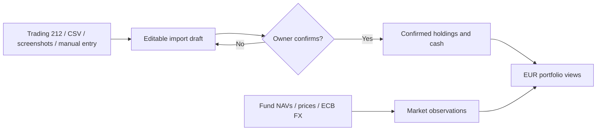

<div align="center">
  <h1>Aggrigator</h1>
  <p>All your investments, together.</p>
  
  <p><strong>A private, local-first workspace for seeing investments from different accounts in one EUR view.</strong></p>
</div>

Track holdings, prices, FX effects and portfolio history without giving the app trading permissions. Import changes enter a review draft; only your explicit confirmation updates the portfolio.

[Explore features](#-what-it-does) · [Run locally](#-quick-start) · [Understand the data flow](#-how-updates-work) · [Architecture](./ARCHITECTURE.md)

---

## ✨ What it does

| Area | Capability |
| --- | --- |
| **One portfolio view** | Combine funds, stocks, bonds and account cash from multiple Source Accounts; show values in EUR. |
| **Flexible imports** | Review Trading 212 read-only syncs, saved CSV holdings, manual entries and screenshot-assisted drafts before changing holdings. |
| **Performance with context** | Switch between investment change and total value; inspect Today, 7-day and 30-day views, holding details, price effects and FX effects. |
| **Price and data health** | Refresh supported fund NAVs, Trading 212 prices and ECB FX rates; inspect freshness, missing baselines and recent refresh results. |
| **Portfolio Agent** | Ask questions about bounded local portfolio facts with cited evidence. Optional cloud features run only with configured provider credentials. |
| **External market watch** | Request an official-source calendar of upcoming macro releases on demand, separate from portfolio facts. |

**Designed for one owner on desktop web.** It monitors investments; it does not place trades or provide investment advice. A fresh database is empty. **Explore demo** shows synthetic data without saving it to your portfolio.

## 🚀 Quick start

**Requirements:** Node.js 22.12+ on the 22.x line, or Node.js 24+, and npm.

```bash
npm install
cp .env.example .env.local
npm run dev
```

Open [http://localhost:3000](http://localhost:3000). No API key is required to explore the synthetic demo or enter holdings manually. The first real portfolio record is created only after an import is reviewed and confirmed.

To exercise the full import flow with synthetic data, choose **Update assets → No API key? Try the demo**.

### Optional connections

Configure these in the ignored `.env.local` file. [`.env.example`](./.env.example) lists the available model and provider settings.

| Connection | Configuration | What it enables |
| --- | --- | --- |
| Trading 212 | `TRADING212_API_KEY`, `TRADING212_API_SECRET`, `TRADING212_ENVIRONMENT` | Read-only account and position sync. Start with `demo`; use a separate Live key with account-data and portfolio read permissions only. |
| OpenAI | `OPENAI_API_KEY` | Screenshot extraction, optional Portfolio Agent and on-demand market watch. Selected screenshots are sent to the configured OpenAI API account. |
| DeepSeek | `DEEPSEEK_API_KEY` | Optional Portfolio Agent provider. |

Keys stay server-side. Trading 212 calls only account summary and positions endpoints; no order permission is needed. Public fund NAV and ECB FX checks do not require account credentials. Keep personal screenshots out of the repository.

## 🔄 How updates work



**Holding State** contains confirmed quantities, cost basis and cash. **Market Data** contains dated prices, NAVs and FX observations. Refreshing prices updates Market Data only; it cannot silently change holdings or cash. A Trading 212 sync that detects holding changes opens a Before/After review, while an unchanged holding state can accept new prices directly. Screenshot drafts show only detected holdings, and confirmation preserves other holdings in that account.

The dashboard checks prices at most once per `Europe/Helsinki` day when a non-empty portfolio loads. **Refresh prices** triggers an explicit retry. If a provider fails, the last successful local price remains available. A manual dated NAV or price can be entered for an existing holding.

Portfolio Agent answers use fresh, bounded facts and validate evidence before a completed answer is saved. Account creation and screenshot imports still require owner confirmation. Screenshots sent in Agent chat are saved in the ignored private `data/agent-images/` directory and referenced by the local conversation so they remain visible after reload. Screenshots submitted through the separate Import page are still temporary. External market watch searches approved official sources only when requested.

## 🧭 Navigate the app

| Page | Use it for |
| --- | --- |
| **Overview** | EUR portfolio summary, performance chart, refresh status, Portfolio Agent and external market watch. |
| **Accounts** | Source Account setup, allocation and account-specific holdings. |
| **Update assets** | Trading 212 sync, screenshot, CSV and manual import drafts, followed by review and confirmation. |
| **Settings** | Portfolio Agent provider defaults and AI privacy controls. |

## 🧱 Technology and project structure

**Next.js 16 · React 19 · TypeScript · SQLite · Vitest**

| Location | Responsibility |
| --- | --- |
| `src/app` | Pages and HTTP routes. |
| `src/components` | Desktop web interface. |
| `src/application` | Read models, import workflows, valuation and Agent orchestration. |
| `src/domain` | Portfolio facts, identities and reconciliation rules. |
| `src/infrastructure` | SQLite and external provider adapters. |
| `tests` | Synthetic automated coverage and opt-in provider evaluations. |

See [ARCHITECTURE.md](./ARCHITECTURE.md) for the data model, valuation rules, provider boundaries and end-to-end workflows.

## 🛠️ Development checks

```bash
npm run typecheck
npm test
npm run build
```

The regular test suite mocks cloud boundaries and uses synthetic data. An opt-in OpenAI vision evaluation is available with `RUN_OPENAI_VISION_EVAL=1 npm test -- tests/evaluation/openai-vision-import.eval.test.ts`; it consumes API usage and uses a committed synthetic image.

### Local data and upgrades

Portfolio records live in the ignored `data/invest-assets-monitor.sqlite` database. Existing v2–v7 databases upgrade to schema v8 in place. A disposable pre-v2 test database is not migrated; if startup identifies one, stop the app and move `data/invest-assets-monitor.sqlite*` out of the active path before restarting. If `PORTFOLIO_DB_FILENAME` is customized, use that basename instead. Keep the moved file locally until you no longer need it.

## 🔒 Privacy and boundaries

- The repository contains application source, tests and build documentation. Personal financial data, raw screenshots, API keys, local databases and working notes stay outside Git.
- Screenshot imports require review and explicit confirmation before they change holdings. Agent chat saves local originals for conversation history; image bytes are sent to OpenAI when you ask about a screenshot or request screenshot extraction.
- The Portfolio Agent is informational. It cannot trade or autonomously change confirmed holdings.
- Cloud AI features are optional. Check the configured provider and privacy settings before sending personal portfolio information.

---

**Project status:** Actively developed as a private, single-user monitor. Current work expands bounded Portfolio Agent tools and conversation-native import review; explicit portfolio events and background automation remain deferred. The app is not a brokerage or investment-advice service.
