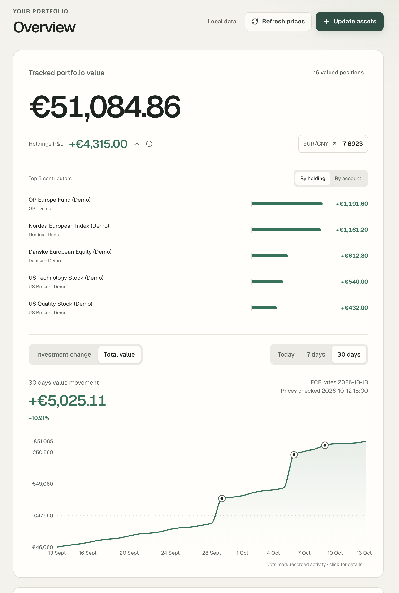
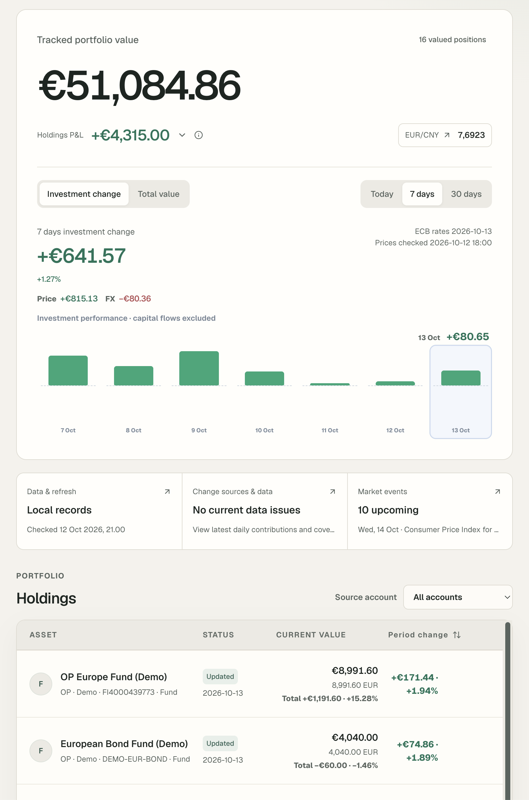
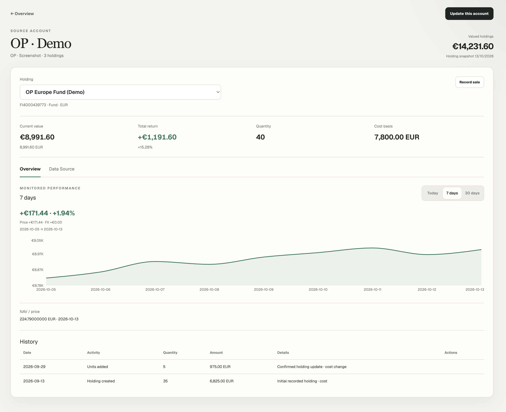
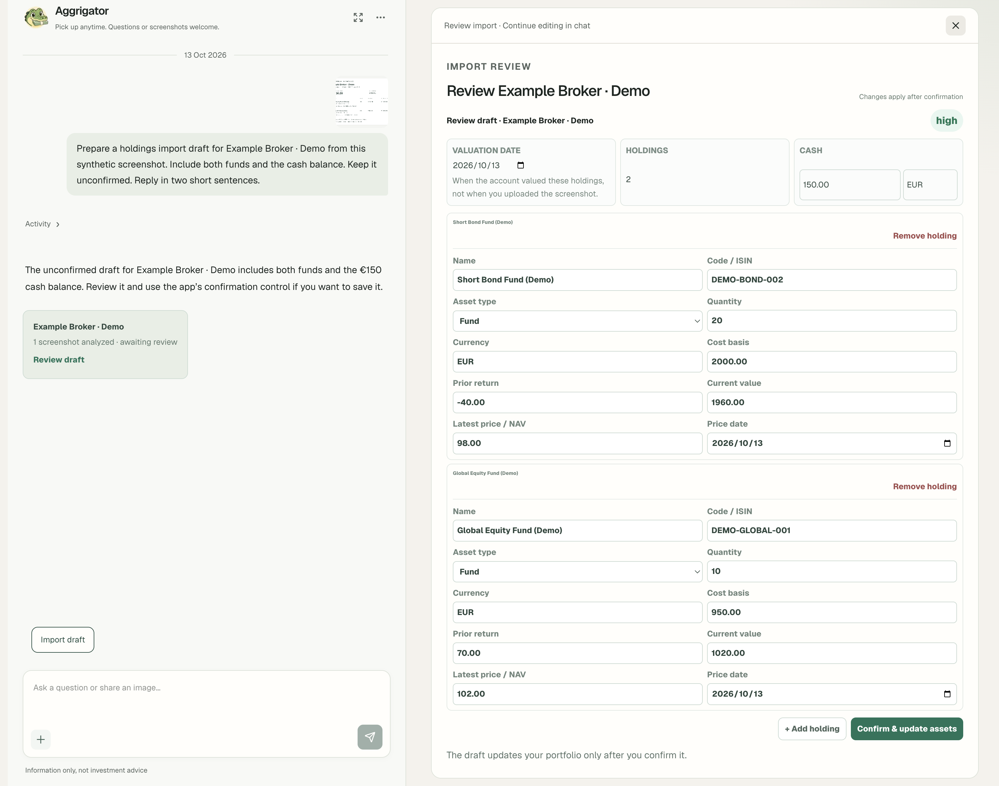
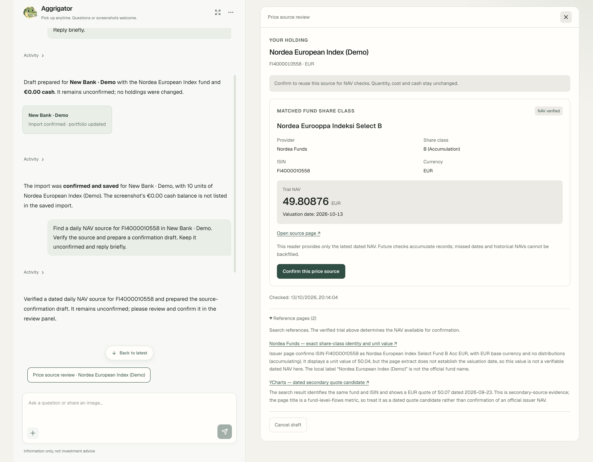
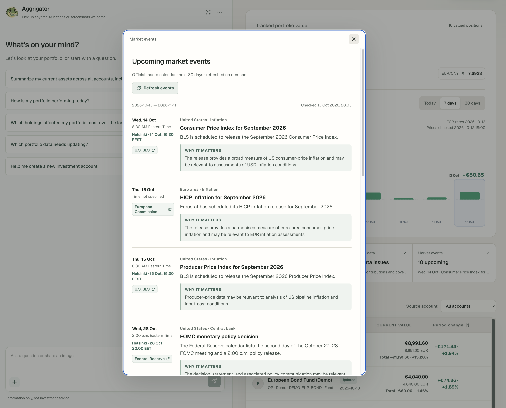

<div align="center">
  <h1>Aggregator</h1>
  <p>Your investments. One view. A sharper perspective.</p>
  
  <p><strong>A personal investment tracker for multiple accounts and currencies, with one EUR view.</strong></p>
</div>

Aggregator helps you understand investments spread across different platforms and currencies without switching between accounts to piece together the whole portfolio. View values in EUR, compare account and holding contributions, and separate price and exchange-rate effects from changes in total value.

Aggregator brings holdings, account cash and recorded history together. Run it on your own computer, enter or import your holdings, and see which investments contribute to changes over time.

**Meet Gator. Make sense of your portfolio.** Gator is the optional AI assistant inside Aggregator. Ask about recorded portfolio facts, share a screenshot, or prepare an update for your review.

This is a personal project in active development, designed for one owner on desktop web. It does not place trades or provide investment advice. There is no hosted service; optional AI features use the OpenAI API.

[See the app](#see-the-app) · [Features](#what-it-does) · [Run locally](#run-locally) · [First use](#your-first-portfolio) · [Understand the numbers](#understand-the-numbers) · [Privacy](#privacy-and-local-data)

<a id="see-the-app"></a>

## 🖼️ See the app

**Demo portfolio · Synthetic data.** All six screenshots use demonstration holdings, balances and simulated performance. They are not personal investment results or official historical prices. A fresh installation starts empty; this demo history is not included.

**Portfolio overview** — Holdings and account cash in EUR, with allocation, contribution and recorded value history.



<details>
<summary>More screenshots: performance, holding details, Agent reviews and market calendar</summary>

**Weekly performance** — Daily investment changes with price and exchange-rate effects.



**Holding details** — Quantity, cost, profit or loss, price history and recorded updates for one holding.



**Screenshot import review** — The assistant prepares a draft. You check the fund and cash values before confirming.



**Fund price-source review** — Find a candidate source, check a supported reader’s dated net asset value (NAV), and explicitly confirm the source before using it for updates.



**Market calendar** — Upcoming economic releases with official-source links, Helsinki times and short explanations.



</details>

<a id="what-it-does"></a>

## ✨ What it does

| Feature | What you can do |
| --- | --- |
| **Accounts in one view** | Track funds, ETFs, stocks, bonds and account cash across platforms and currencies, with combined values in EUR. |
| **Change analysis** | Compare total value with investment change, inspect holding contributions, and separate price effects from exchange-rate effects. |
| **Recorded history** | Inspect individual holdings, confirmed updates, completed sales and cash withdrawals. |
| **Reviewed asset updates** | Use manual entry, CSV, screenshots or a read-only Trading 212 connection. Proposed holding changes need review and explicit confirmation. |
| **Gator · Optional AI assistant** | Ask about recorded portfolio facts, prepare screenshot imports, edit supported draft fields, or find and verify supported fund price sources. Answers link to evidence; Gator cannot confirm asset changes for you. |
| **Market context** | Request upcoming economic releases from official sources or ask for web research. External explanations remain separate from calculated portfolio facts. |

Price checks update dated market observations. They cannot silently change quantities, cost basis or cash. Creating an account does not automatically connect it to a price provider.

<a id="run-locally"></a>

## 🚀 Run locally

You need **Node.js 22.12+ on the 22.x line, or Node.js 24+, and npm**. SQLite is included through Node.js; there is no separate database server to install.

Download or clone this repository, open a terminal in its folder, then run:

```bash
npm install
cp .env.example .env.local
npm run dev
```

Open [http://localhost:3000](http://localhost:3000). Leave the API key fields empty to try manual entry without cloud AI or API charges. The development server must stay running while you use the app.

## Your first portfolio

A fresh database starts with **no accounts or holdings**. Existing local databases retain their accounts and data.

Try these synthetic values before entering personal records:

1. Open **Accounts → Create account** and enter an account type such as `Example Broker`.
2. Open **Update assets**, select that account, choose **Enter manually**, and select **+ Add holding**.
3. Enter `Example EUR Fund` as the name, `EXAMPLE-EUR` as the code, and **Fund** as the asset type. Use quantity `2`, currency `EUR`, historical cost basis `180`, prior cumulative return `20`, latest price / NAV `100`, and current value `200`. Use today’s date for both valuation and price dates.
4. Review the values and select **Confirm 1 changes**. **Overview** should show an investment worth EUR 200 and holdings profit of EUR 20 (11.11%). Reload to check that the holding remains saved.

Then add your other accounts and holdings. Alipay, WeChat, Danske Bank and Trading 212 are recognized account types; other account names can use manual or screenshot imports. CSV is another import option. Recognition does not guarantee automatic price coverage.

**History takes time to build.** The first day gives you a snapshot. Seven-day and thirty-day views need dated records and price/FX baselines; until those exist, analysis can be partial or unavailable. Regular updates make the history more useful, but the app does not reconstruct a complete brokerage transaction history.

| Page | Main use |
| --- | --- |
| **Overview** | Portfolio summary, performance, refresh status, Agent and market calendar. |
| **Accounts** | Create accounts, inspect allocation and account holdings. |
| **Update assets** | Prepare, edit and confirm import drafts. |
| **Settings** | Configure AI, Agent preferences and confirmed memories. |

## Optional connections

### OpenAI

In **Settings → AI provider**, enter an OpenAI model ID and your API key, then save. New settings apply to the next AI request without restarting. Use a model that supports the features you want, including image input for screenshot tasks.

This enables Agent chat, screenshot extraction, web research and the market calendar. Requests incur charges on your API account. They send conversation content, attached images and relevant portfolio facts to OpenAI; the AI features are not local processing.

Leave the key field blank to retain a saved key, or select **Remove key** to disable AI features. Saved settings override OpenAI environment values, including the model used for screenshot and research requests. Environment-based configuration remains available in [`.env.example`](./.env.example).

### Trading 212

Set `TRADING212_API_KEY`, `TRADING212_API_SECRET` and `TRADING212_ENVIRONMENT` in your ignored `.env.local` file. Start with `demo`; a Live account needs a separate Live key. Grant account-data and portfolio **read permissions only**. Order permissions are not needed.

The connection reads account summary and positions. Holding changes enter a review draft; unchanged holdings can receive new prices directly.

### Public prices and exchange rates

Supported public fund NAV sources and ECB exchange-rate checks do not require account credentials. Automatic price coverage is limited to specific readers and instruments, as described below.

<a id="understand-the-numbers"></a>

## 📊 Understand the numbers

| Number | What it means |
| --- | --- |
| **Total value** | Recorded holdings and account cash, valued in EUR. Changes can include asset updates, withdrawals, prices and FX. |
| **Current holdings P&L** | Profit or loss on investments still held, relative to their recorded cost. The percentage is weighted by cost. Cash and realized gains on sold holdings are excluded. |
| **Investment change** | Price and FX movement over a period, calculated using current holding quantities to separate it from quantity changes. It is not a complete transaction-based return. |
| **Price effect / FX effect** | The parts of investment change attributed to the asset’s price and to its currency’s value against EUR. |
| **Contributions** | How much individual holdings contribute to the period’s investment change, subject to available baselines and valuations. |

For example, adding EUR 1,000 can increase total value by EUR 1,000 without producing an investment gain. A USD holding can also gain value in EUR even if its USD price stays unchanged, because the exchange rate moved.

Check data dates and coverage alongside the numbers. Missing prices, missing FX rates, different observation windows and closed holdings can limit comparisons. Estimated other value movement is a difference between calculations, not verified net deposits or a full classification of transactions.

## Current support and limits

- **Automatic prices:** Supported six-digit Alipay/WeChat fund codes, configured Trading 212 positions, and specific OP, Danske and Nordea funds have readers. Other holdings need manual updates or a supported source. A web search result alone cannot enable automatic refresh.
- **Source confirmation:** The Agent can search public pages and prepare a review, but only a verified supported reader can be confirmed. Source confirmation itself does not write a price observation.
- **Refresh schedule:** A non-empty dashboard checks prices at most once per Helsinki calendar day, with limited retries for eligible failures. **Refresh prices** requests a manual retry. There is no background scheduler while the app is closed.
- **Historical coverage:** Some sources provide only the latest dated NAV. These accumulate observations as you use the app; they cannot backfill missed days. Failed checks retain the last recorded price and its date.
- **Activity:** Recorded sales and withdrawals are supported, but history is not a complete broker ledger. Imported quantity increases are recorded as units added, without inventing a purchase transaction.
- **Screenshot accuracy:** Extraction can be wrong or incomplete. Check the account, quantities, currency, dates and amounts before confirming.

The public fund-source pilot supports OP-Europe Fund A (`FI4000439773`, EUR), Danske Invest Eurooppa Osake K (`FI0008802988`, EUR), and Nordea Eurooppa Indeksi Select B (`FI4000010558`, EUR). OP uses a Financial Times reader with limited recent history; Nordea provides only the latest dated NAV. Other supported Danske funds require a private local mapping that is not included in the repository.

<a id="privacy-and-local-data"></a>

## 🔒 Privacy and local data

Portfolio records live in the ignored `data/invest-assets-monitor.sqlite` database. Chat images are stored in `data/agent-images/` for conversation history. Saved AI credentials live server-side in `data/ai-provider-settings.json` with owner-only file permissions; the browser receives their configured status, not the key. Trading 212 credentials stay in `.env.local`.

In **Accounts**, **Delete** opens a review of the account and its local portfolio data. Type the exact account name and check the confirmation box to enable **Delete account and data**. This permanently removes that account's holdings, cash, snapshots, imports, activity, saved prices and price sources in one transaction. Portfolio totals and history are recalculated, and saved portfolio analysis is cleared. Other accounts, shared exchange rates, saved chats, local backups and credentials are kept. Deletion cannot be undone in the app.

On the desktop overview, click Gator's avatar at the upper left to minimize the chat. The avatar stays in place as a floating button while the panel smoothly contracts toward it. The portfolio area uses the full available width, with space for the avatar reserved only beside the heading or review toolbar. Click the same avatar to restore the chat. The transition takes 0.36 seconds and respects the system's reduced-motion setting. Unsent text, attachments and in-progress replies stay in place. The browser remembers the panel state; choosing **Explore reasons for gains and losses** from a detail view opens the chat again.

Agent requests include the full saved conversation text and original attached images, as well as relevant portfolio facts. Original images remain part of subsequent chat requests until the conversation is reset. Screenshots uploaded through the separate **Update assets** page are temporary rather than saved as chat images.

For a local backup, stop the app and copy the `data/` folder and `.env.local` to a private location. That backup may contain financial records, screenshots and API keys. Keep it out of Git and public file sharing. The repository ignores these files; demo screenshots and test fixtures use synthetic data.

## Development and feedback

**Next.js 16 · React 19 · TypeScript · SQLite · Vitest**

```bash
npm run typecheck
npm test
npm run build
```

Regular tests use synthetic data and mocked cloud boundaries. Real API evaluations are opt-in and incur costs; they are not required to try the app locally.

Feedback and issue reports are welcome. Include the steps to reproduce and the expected result; use synthetic or redacted examples rather than personal financial records, credentials or raw account screenshots.

## License

Licensed under the [MIT License](./LICENSE).
