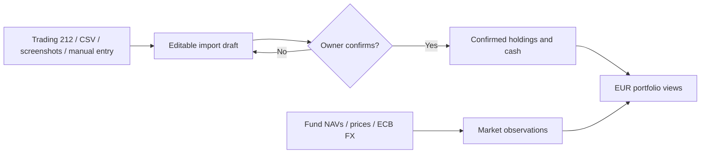

<div align="center">
  <h1>Aggrigator</h1>
  <p>All your investments, together.</p>
  
  <p><strong>A local-first investment workspace that brings multiple accounts and currencies into one EUR view.</strong></p>
</div>

Run it on your own computer, keep portfolio records locally, and optionally connect AI tools to explore changes with cited evidence.

Track holdings, prices, FX effects and portfolio history without giving the app trading permissions. Import changes enter a review draft; only your explicit confirmation updates the portfolio.

[Explore features](#-what-it-does) · [Run locally](#-quick-start) · [Understand the data flow](#-how-updates-work) · [Architecture](./ARCHITECTURE.md)

---

## ✨ What it does

| Area | Capability |
| --- | --- |
| **One portfolio view** | Combine funds, stocks, bonds and account cash from multiple Source Accounts; show values in EUR. |
| **Flexible imports** | Review Trading 212 read-only syncs, saved CSV holdings, manual entries and screenshot-assisted drafts before changing holdings. |
| **Current holdings P&L** | See profit or loss for currently held investments, with a cost-weighted percentage and data coverage. Excludes cash and realized gains from sold holdings. |
| **Performance with context** | Switch between investment change and total value; inspect Today, 7-day and 30-day contributions, drill into individual holdings, and separate price effects from FX effects. |
| **Recorded activity** | Record completed sales and cash withdrawals with review and confirmation; inspect saved activity in holding and account history. |
| **Price and data health** | Refresh supported fund NAVs, Trading 212 prices and ECB FX rates; inspect freshness, missing baselines and recent refresh results. |
| **Portfolio Agent** | Ask questions about bounded local portfolio facts with cited evidence. Optional cloud features run only with configured provider credentials. |
| **External market watch** | Request an official-source calendar of upcoming macro releases on demand, separate from portfolio facts. |

**Designed for one owner on desktop web.** It monitors investments; it does not place trades or provide investment advice. A fresh database is empty until an import is reviewed and confirmed.

## 🚀 Quick start

**Requirements:** Node.js 22.12+ on the 22.x line, or Node.js 24+, and npm.

```bash
npm install
cp .env.example .env.local
npm run dev
```

Open [http://localhost:3000](http://localhost:3000). No API key is required to enter holdings manually. The first portfolio record is created only after an import is reviewed and confirmed.

A fresh database includes empty Alipay, WeChat Wealth Management, Danske Bank and Trading 212 accounts. You can add other account types through **Accounts**. Creating an account does not automatically configure a price provider.

### Try a first portfolio without API keys

Use synthetic values before entering your own records:

1. Open **Accounts**, select **Create account**, and enter an account type such as `Example Broker`.
2. Open **Update assets**, select that account, choose **Enter manually**, and select **+ Add holding**.
3. Enter `Example EUR Fund` as the name, `EXAMPLE-EUR` as the code, and **Fund** as the asset type. Set quantity to `2`, currency to `EUR`, historical cost basis to `180`, prior cumulative return to `20`, latest price / NAV to `100`, and current value to `200`. Use today's date for the valuation and price dates.
4. Review the values and select **Confirm 1 changes**. Open **Overview**: the investment should be worth EUR 200, with holdings P&L of EUR 20 (11.11%). Reload the page to check that the holding remains saved.

A new portfolio does not yet have a 7-day or 30-day baseline. Those views show unavailable or partial history until enough dated records exist. AI chat and screenshot analysis require your own OpenAI API key and incur API charges; manual entry does not.

### Optional connections

Configure these in the ignored `.env.local` file. [`.env.example`](./.env.example) lists the available model and provider settings.

| Connection | Configuration | What it enables |
| --- | --- | --- |
| Trading 212 | `TRADING212_API_KEY`, `TRADING212_API_SECRET`, `TRADING212_ENVIRONMENT` | Read-only account and position sync. Start with `demo`; use a separate Live key with account-data and portfolio read permissions only. |
| OpenAI | `OPENAI_API_KEY` | Screenshot extraction, optional Portfolio Agent with source-linked web research, and on-demand market watch. Selected screenshots and agent web queries are sent to the configured OpenAI API account. |

Keys stay server-side. Trading 212 calls only account summary and positions endpoints; no order permission is needed. Public fund NAV and ECB FX checks do not require account credentials. Keep personal screenshots out of the repository.

### Portfolio Agent

With your own OpenAI API key, use chat to explore your portfolio and prepare changes:

- Ask which holdings drove a period's gains or losses, then inspect the cited facts and full contribution details.
- Ask about a holding's recorded history or an account's sales and withdrawals.
- Discuss screenshots, prepare import or completed-sale drafts, and edit supported draft fields in conversation. Review and explicitly confirm changes before they affect assets.
- Request web research for possible market explanations with source links. External explanations remain separate from calculated portfolio changes.
- Ask the Agent to find a fund NAV source by ISIN. It delegates public identity to a dedicated search role, probes supported readers and saves a review in the conversation. Confirm a verified source explicitly. The saved binding returns a structured operation result to the main Agent for its reply; confirmation itself does not write price observations. Candidate webpages without a supported reader remain research links and cannot enable automatic refresh. This pilot supports OP-Europe Fund A (`FI4000439773`, EUR), Danske Invest Eurooppa Osake K (`FI0008802988`, EUR), and Nordea Eurooppa Indeksi Select B (`FI4000010558`, EUR); it does not generate executable adapters for arbitrary websites.
- Ask to save a preference or background detail as a memory; review and confirm the proposed wording before it is stored.

AI features send conversation content, attached images and relevant portfolio facts to the configured OpenAI API account and incur API charges. The Agent cannot trade or confirm portfolio changes for you.

### Automatic price coverage

Price updates currently use specific supported providers; arbitrary account types do not acquire a data connection automatically:

| Holdings | Current update support |
| --- | --- |
| Alipay / WeChat CNY funds and ETFs | Eastmoney NAV history when a supported six-digit fund code is available. Name-only source discovery is limited to one predefined WeChat fund candidate. |
| Danske EUR holdings | Eurooppa Osake K (`FI0008802988`, EUR) has a public identity-checked reader available through Agent or holding-detail confirmation in any account. Other supported Danske ISINs use the local `data/danske-invest-funds.json` mapping; this private mapping is not included in the repository. |
| OP-Europe Fund A (`FI4000439773`, EUR) in any account | One verified Financial Times historical-price adapter. Open the fund detail and explicitly confirm its price source before refresh can use it. The binding survives restart; the Agent can also prepare this confirmation review from a natural-language request. |
| Nordea Eurooppa Indeksi Select B (`FI4000010558`, EUR) in any account | Identity-checked official Nordea Funds reader. Explicit source confirmation is required. Reads the latest dated NAV only; subsequent checks accumulate observations, without backfilling history or missed days. |
| Trading 212 positions | Prices for confirmed positions through your configured read-only Trading 212 connection. |
| Other holdings / account types | Manual imports and dated manual prices. Agent research can find candidate pages, but automatic updates require a supported reader and explicit confirmation. |

The daily price check runs when a non-empty portfolio loads in the dashboard, at most once per Helsinki calendar day, with a limited retry for eligible failures. It is not a background job that runs while the app is closed. Missing or failed updates retain the last recorded price and its date.

## 🔄 How updates work



**Holding State** contains confirmed quantities, cost basis and cash. **Market Data** contains dated prices, NAVs and FX observations. Refreshing prices updates Market Data only; it cannot silently change holdings or cash. A Trading 212 sync that detects holding changes opens a Before/After review, while an unchanged holding state can accept new prices directly. Screenshot drafts show only detected holdings, and confirmation preserves other holdings in that account.

On an account's holding detail page, **Record sale** takes the completed sale's gross amount and date. For funds, a saved Eastmoney or Danske Invest NAV for that exact date and currency calculates the units sold. Otherwise, enter the actual units from the sale confirmation; stocks and ETFs always need actual units. An optional actual-unit override takes priority over NAV calculations. Fees default to zero under **More settings**. A short summary shows net proceeds, profit or loss, remaining units, and destination before saving. Choose whether net proceeds stay in the investment account or go to a named external account. External proceeds leave the tracked total immediately; the app does not track external bank balances or settlement delays. **Record cash transfer out** handles cash withdrawn later. Both actions require review and a separate confirmation. Changed holdings or cash invalidate the preview.

Each holding's **History** lists its initial recorded position, confirmed quantity or cost changes, and sales. History is scoped to the selected holding; selecting account cash shows only withdrawals in that currency. Imported increases are labelled **Units added**, rather than inferred purchases. History keeps sale destinations and supports confirmed undo, followed by a corrected entry. Undone records remain visible. Undo is blocked by later account activity, a newer import, or insufficient cash to reverse retained proceeds. Undoing an imported sale restores its quantity and cost basis while preserving other imported holdings and price updates.

Screenshot and Trading 212 reviews detect reduced quantities, including holdings removed from a complete broker snapshot. Before confirmation, identify each reduction as a sale/redemption with proceeds, fees and destination, or an explained quantity correction. Omitted screenshot holdings remain unchanged. Imported cash balances are authoritative and sale proceeds are not added twice. A sale already recorded manually is not recorded again when the updated holdings are imported. Transfers out reduce tracked value and are separate from investment performance.

The dashboard checks prices at most once per `Europe/Helsinki` day when a non-empty portfolio loads. **Refresh prices** triggers an explicit retry. If a provider fails, the last successful local price remains available. A manual dated NAV or price can be entered for an existing holding. A newly confirmed price source receives its first automatic check even if other prices were checked earlier that day. Checks run when the app is open; there is no background scheduler while it is closed.

Portfolio Agent can read one holding’s recorded creation, quantity/cost updates and sales through `read_holding_history`, and one account’s sales and withdrawals through `read_account_activity`. Both tools are read-only, accept optional inclusive date bounds, and return at most the newest 20 matching records with coverage counts. Closed holdings remain searchable. Undone records, missing destinations, net proceeds and realized sale results are separate facts; external transfers are not investment losses. Saved history is not a complete broker transaction history.

Upload one completed sale/redemption screenshot in Agent chat and ask to record the sale. OpenAI prepares an editable draft; it never writes holdings directly. Check the account, holding, date, actual units, gross versus net amount, fee and proceeds destination in the review panel. Supply missing values in the form or in chat, then review the summary and explicitly confirm. A matching dated fund NAV can estimate units when actual units are absent; estimates are labeled. Pending orders and multi-transaction screenshots are rejected. Drafts survive reload, exact image re-uploads are blocked after saving, and similar transactions require an extra acknowledgement. Saved sales use the existing History undo workflow. Sale operation results are passed to the same Agent through the read-only `read_workflow_result` tool. The Agent uses current operation facts, conversation context and confirmed preferences to write acknowledgements and failure explanations. If reply generation fails, the operation stays recorded; Retry Agent reply generates only the message, never repeats the sale.

The main Agent selects `prepare_sale_draft`, `read_sale_draft`, `update_sale_draft`, `cancel_sale_draft` and `review_sale_draft` for completed sales described in text or a saved screenshot. Pending screenshot imports use `read_import_draft`, `update_import_draft`, `cancel_import_draft` and `review_import_draft`; Conversational edits cover dates, instrument codes, holding names, quantities, currencies, cost and price fields. Draft tools cannot confirm holdings changes. Import, sale, and memory review open beside chat in the right workspace panel, so the user can edit the same draft manually or in conversation. Manual saves finish before the next Agent request. Use the review panel's explicit confirmation control to save. Unrelated portfolio questions can be answered while a draft is pending. Import and sale outcomes share the persisted workflow-result reply path and `/api/portfolio/analyst/workflow/reply` retries only the explanation.

The composer lists unfinished import drafts, sale drafts, and memory proposals vertically, highlighting the current item. Each shortcut shows only its fixed draft type; account names and memory text are shown in review. Select a row to review it in the right workspace while continuing to chat. Closing review or choosing Review later preserves the draft; the row’s cancel button explicitly discards only that pending item. Completing or cancelling removes it. The selected item is remembered locally across reloads, with unfinished business state restored from the saved conversation and drafts.

Answer-linked **View contribution** opens a full read-only period analysis beside chat, independent of the answer's bounded evidence subset. Switch between latest holding moves, 7 days and 30 days; sort signed EUR contributions and open a holding's dates, price/FX components, saved price sources and relevant records. The detail view reads current stored data without refreshing prices or changing assets; the original answer evidence remains a separate dated snapshot. Contributions use the dashboard's current-quantity method, not realized transaction returns. Missing valuations/baselines, partial windows, excluded exited holdings and reconciliation residuals remain visible. Latest moves can compare different observation windows across holdings. Transfers out are separate from investment losses, and estimated other value movement is not verified net deposits.

**Explore reasons for gains and losses** fills a concise, date-bound question within the chat's 600-character limit, without sending it or overwriting existing text. Research begins when the owner sends the question. A collapsed execution record shows the current activity; expanding it lists chronological tool calls, statuses and returned websites. Saved execution audits remain above their answers. Websites appear as compact domain links once each search finishes, and remain available below the answer. Each domain link opens the actual source page. External explanations distinguish source publication dates, event dates and retrieval time; sources with unknown dates cannot establish period membership. Returned URLs are checked independently against the actual search sources. Possible market causes remain interpretations, separate from calculated price/FX effects; research does not update saved prices.

Agent chat uses one multimodal main Agent for text and image messages. Every request includes the full saved conversation text, assistant replies and original images; chat history is not truncated or summarized. Image content is supplied directly to the configured main model, together with confirmed preferences. Users may explain any image, continue discussing it, then refer to an earlier numbered image to prepare an import or completed-sale draft. The main Agent supplies structured data to draft tools; chat no longer calls a separate image-intent router or image-observation model. Mixed requests can combine image explanations with portfolio reads or web research in one answer. Direct screenshot observations use image evidence keys; current account and market claims still require tool evidence. Follow-up questions use the latest request rather than repeating an earlier research topic. Images do not authorize writes. Progress uses the same activity indicator; retry actions appear only for incomplete replies and never repeat a saved operation. The separate Import page retains its existing screenshot extraction workflow.

Portfolio Agent answers use fresh, bounded facts and validate evidence before a completed answer is saved. The model receives the complete multimodal conversation history. Up to five short, explicitly confirmed memories are saved separately from the conversation. The main Agent normalizes explicitly requested preferences and user-reported background into a concise sentence, preserving conditions, exceptions and time qualifiers without inventing facts. It does not create memories from incidental statements. The same Agent can read confirmed memories through `read_memories` and draft a requested preference through `propose_memory`. A proposal appears in the right review panel as editable text. Edits automatically persist as a pending draft before another Agent request or confirmation; confirmation stores the edited wording without summarizing it again. Closing review preserves the draft. A proposal becomes a confirmed memory only after confirmation; the original chat message remains in the conversation. A failed proposal never saves the raw request as memory. Memories can be reviewed, edited, or deleted in Settings. A failed read tool returns a safe error to the Agent, which can explain the missing data or use other successful reads. Failed model answers are retained as conversation turns so the user's question remains visible. Account creation and screenshot imports still require owner confirmation. Screenshots sent in Agent chat are saved in the ignored private `data/agent-images/` directory and referenced by the local conversation so they remain visible after reload. Screenshots submitted through the separate Import page are still temporary. External market watch searches approved official sources only when requested.

## 🧭 Navigate the app

| Page | Use it for |
| --- | --- |
| **Overview** | EUR portfolio summary, performance chart, refresh status, Portfolio Agent and external market watch. |
| **Accounts** | Source Account setup, allocation and account-specific holdings. |
| **Update assets** | Trading 212 sync, screenshot, CSV and manual import drafts, followed by review and confirmation. |
| **Settings** | Portfolio Agent language, default analysis period and OpenAI model information. |

## 🧱 Technology and project structure

**Next.js 16 · React 19 · TypeScript · SQLite · Vitest**

| Location | Responsibility |
| --- | --- |
| `src/app` | Pages and HTTP routes. |
| `src/components` | Desktop web interface. |
| `src/application` | Read models, import workflows, valuation and Agent orchestration. |
| `src/domain` | Portfolio facts, identities and reconciliation rules. |
| `src/infrastructure` | SQLite and external provider adapters. |
| `tests` | Synthetic automated coverage and opt-in provider evaluations. |

See [ARCHITECTURE.md](./ARCHITECTURE.md) for the data model, valuation rules, provider boundaries and end-to-end workflows.

## 🛠️ Development checks

```bash
npm run typecheck
npm test
npm run build
```

The regular test suite mocks cloud boundaries and uses synthetic data. Run `RUN_PORTFOLIO_MULTIMODAL_EVAL=1 npm test -- tests/evaluation/portfolio-agent-multimodal.eval.test.ts` for a real API check using the configured main Agent and web research. It sends a synthetic image, checks mixed research/image answers and image follow-up, then resolves an ambiguous account choice and prepares a draft through the production tools in a disposable database. It checks confirmed memory, named-holding quantity edits, preservation of other draft fields, and that assets stay unchanged. Add `PORTFOLIO_EVAL_DRAFT_ONLY=1` to run only account clarification, historical-image import, and named-holding editing without web research. After an approved retry, `PORTFOLIO_EVAL_PRIOR_API_REQUESTS` deducts earlier attempts from the same 12-request limit; it does not expand the budget. This opt-in check applies a gate of 12 API requests and US$0.10 estimated cost per run, counting main-model calls and web research. Missing usage or unknown pricing stops further requests. It saves synthetic replies, tool names, usage and estimated cost to ignored `data/evaluations/multimodal-latest.json`. Prices are estimates, not invoices. This opt-in check consumes API usage and never uses the owner's portfolio database or confirms an import. The fund-source Agent check is available with `RUN_PRICE_SOURCE_EVAL=1 npm test -- tests/evaluation/price-source-agent.eval.test.ts`. It uses public OP, Danske and Nordea identities with synthetic positions in disposable databases and checks persisted review states without confirming sources or imports. Set `PRICE_SOURCE_EVAL_BANK=Danske` or `Nordea` to check only that bank after changing its reader. Main-model and research calls share the same 12-request / US$0.10 gate. Deduct earlier attempts with `PRICE_SOURCE_EVAL_PRIOR_API_REQUESTS` and `PRICE_SOURCE_EVAL_PRIOR_ESTIMATED_USD` when continuing an approved run; reports stay in ignored `data/evaluations/price-source-agent.json`. A persisted review can survive a blocked final reply. An opt-in OpenAI vision evaluation is available with `RUN_OPENAI_VISION_EVAL=1 npm test -- tests/evaluation/openai-vision-import.eval.test.ts`; it consumes API usage and uses a committed synthetic image.

Run `RUN_PORTFOLIO_MEMORY_EVAL=1 npm test -- tests/evaluation/portfolio-agent-memory.eval.test.ts` for four small real-model memory scenarios: temporary background, conditional preferences, an incidental statement, and applying confirmed background with a requested answer language. This uses the same 12-request/US$0.10 gate and a disposable database; reports remain ignored under `data/evaluations/`.

Run `RUN_PORTFOLIO_CONTRIBUTION_EVAL=1 npm test -- tests/evaluation/portfolio-contribution.eval.test.ts` for local contribution arithmetic, historical market reasons and unavailable research. It uses synthetic holdings and the same request/cost gate. `PORTFOLIO_CONTRIBUTION_EVAL_ONLY=local|research|unavailable` selects a scenario; retries must deduct prior requests and cost through `PORTFOLIO_EVAL_PRIOR_API_REQUESTS` and `PORTFOLIO_EVAL_PRIOR_ESTIMATED_USD`. A diagnostic replay can validate previously saved public search output without paying for another search; replay does not prove a new live search succeeded. Reports and public diagnostic output stay ignored locally.

### Local data and upgrades

Portfolio records live in the ignored `data/invest-assets-monitor.sqlite` database. The existing filename is retained when the project is renamed so local portfolios remain available. Existing v2–v11 databases upgrade to schema v12 in place. A disposable pre-v2 test database is not migrated; if startup identifies one, stop the app and move `data/invest-assets-monitor.sqlite*` out of the active path before restarting. If `PORTFOLIO_DB_FILENAME` is customized, use that basename instead. Keep the moved file locally until you no longer need it.

## 🔒 Privacy and boundaries

- The repository contains application source, tests and build documentation. Personal financial data, raw screenshots, API keys, local databases and working notes stay outside Git.
- Screenshot imports require review and explicit confirmation before they change holdings. Agent chat saves local originals for conversation history; original image bytes remain part of subsequent Agent chat requests until the conversation is reset.
- The Portfolio Agent is informational. It cannot trade or autonomously change confirmed holdings.
- Agent web research accepts search results from any public HTTPS site and shows source links. Search summaries do not update saved holding prices; unit NAV answers use dated prices already recorded in the portfolio.
- Cloud AI features are optional. Portfolio Agent uses OpenAI and includes relevant holding names and symbols when answering portfolio questions.

---

**Project status:** Actively developed for single-user use on desktop. Current features include reviewed imports, recorded sales and withdrawals, current holdings P&L, period contribution analysis, and a Portfolio Agent with cited evidence. Historical analysis depends on locally recorded data and is not a complete brokerage transaction history. The app is not a brokerage or investment-advice service.

## License

Licensed under the [MIT License](./LICENSE).
