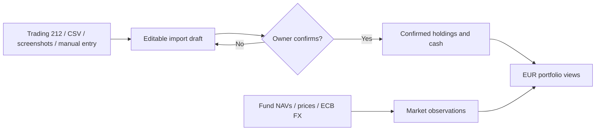

<div align="center">
  <h1>Aggrigator</h1>
  <p>All your investments, together.</p>
  
  <p><strong>A private, local-first workspace for seeing investments from different accounts in one EUR view.</strong></p>
</div>

Track holdings, prices, FX effects and portfolio history without giving the app trading permissions. Import changes enter a review draft; only your explicit confirmation updates the portfolio.

[Explore features](#-what-it-does) · [Run locally](#-quick-start) · [Understand the data flow](#-how-updates-work) · [Architecture](./ARCHITECTURE.md)

---

## ✨ What it does

| Area | Capability |
| --- | --- |
| **One portfolio view** | Combine funds, stocks, bonds and account cash from multiple Source Accounts; show values in EUR. |
| **Flexible imports** | Review Trading 212 read-only syncs, saved CSV holdings, manual entries and screenshot-assisted drafts before changing holdings. |
| **Performance with context** | Switch between investment change and total value; inspect Today, 7-day and 30-day views, holding details, price effects and FX effects. |
| **Price and data health** | Refresh supported fund NAVs, Trading 212 prices and ECB FX rates; inspect freshness, missing baselines and recent refresh results. |
| **Portfolio Agent** | Ask questions about bounded local portfolio facts with cited evidence. Optional cloud features run only with configured provider credentials. |
| **External market watch** | Request an official-source calendar of upcoming macro releases on demand, separate from portfolio facts. |

**Designed for one owner on desktop web.** It monitors investments; it does not place trades or provide investment advice. A fresh database is empty until an import is reviewed and confirmed.

## 🚀 Quick start

**Requirements:** Node.js 22.12+ on the 22.x line, or Node.js 24+, and npm.

```bash
npm install
cp .env.example .env.local
npm run dev
```

Open [http://localhost:3000](http://localhost:3000). No API key is required to enter holdings manually. The first portfolio record is created only after an import is reviewed and confirmed.

### Optional connections

Configure these in the ignored `.env.local` file. [`.env.example`](./.env.example) lists the available model and provider settings.

| Connection | Configuration | What it enables |
| --- | --- | --- |
| Trading 212 | `TRADING212_API_KEY`, `TRADING212_API_SECRET`, `TRADING212_ENVIRONMENT` | Read-only account and position sync. Start with `demo`; use a separate Live key with account-data and portfolio read permissions only. |
| OpenAI | `OPENAI_API_KEY` | Screenshot extraction, optional Portfolio Agent with source-linked web research, and on-demand market watch. Selected screenshots and agent web queries are sent to the configured OpenAI API account. |

Keys stay server-side. Trading 212 calls only account summary and positions endpoints; no order permission is needed. Public fund NAV and ECB FX checks do not require account credentials. Keep personal screenshots out of the repository.

## 🔄 How updates work



**Holding State** contains confirmed quantities, cost basis and cash. **Market Data** contains dated prices, NAVs and FX observations. Refreshing prices updates Market Data only; it cannot silently change holdings or cash. A Trading 212 sync that detects holding changes opens a Before/After review, while an unchanged holding state can accept new prices directly. Screenshot drafts show only detected holdings, and confirmation preserves other holdings in that account.

On an account's holding detail page, **Record sale** takes the completed sale's gross amount and date. For funds, a saved Eastmoney or Danske Invest NAV for that exact date and currency calculates the units sold. Otherwise, enter the actual units from the sale confirmation; stocks and ETFs always need actual units. An optional actual-unit override takes priority over NAV calculations. Fees default to zero under **More settings**. A short summary shows net proceeds, profit or loss, remaining units, and destination before saving. Choose whether net proceeds stay in the investment account or go to a named external account. External proceeds leave the tracked total immediately; the app does not track external bank balances or settlement delays. **Record cash transfer out** handles cash withdrawn later. Both actions require review and a separate confirmation. Changed holdings or cash invalidate the preview.

Each holding's **History** lists its initial recorded position, confirmed quantity or cost changes, and sales. History is scoped to the selected holding; selecting account cash shows only withdrawals in that currency. Imported increases are labelled **Units added**, rather than inferred purchases. History keeps sale destinations and supports confirmed undo, followed by a corrected entry. Undone records remain visible. Undo is blocked by later account activity, a newer import, or insufficient cash to reverse retained proceeds. Undoing an imported sale restores its quantity and cost basis while preserving other imported holdings and price updates.

Screenshot and Trading 212 reviews detect reduced quantities, including holdings removed from a complete broker snapshot. Before confirmation, identify each reduction as a sale/redemption with proceeds, fees and destination, or an explained quantity correction. Omitted screenshot holdings remain unchanged. Imported cash balances are authoritative and sale proceeds are not added twice. A sale already recorded manually is not recorded again when the updated holdings are imported. Transfers out reduce tracked value and are separate from investment performance.

The dashboard checks prices at most once per `Europe/Helsinki` day when a non-empty portfolio loads. **Refresh prices** triggers an explicit retry. If a provider fails, the last successful local price remains available. A manual dated NAV or price can be entered for an existing holding.

Portfolio Agent can read one holding’s recorded creation, quantity/cost updates and sales through `read_holding_history`, and one account’s sales and withdrawals through `read_account_activity`. Both tools are read-only, accept optional inclusive date bounds, and return at most the newest 20 matching records with coverage counts. Closed holdings remain searchable. Undone records, missing destinations, net proceeds and realized sale results are separate facts; external transfers are not investment losses. Saved history is not a complete broker transaction history.

Portfolio Agent answers use fresh, bounded facts and validate evidence before a completed answer is saved. The model sees up to five recent exchanges with bounded text. Up to five short, explicitly confirmed memories are saved separately from the conversation. The same Agent can read confirmed memories through `read_memories` and draft a requested preference through `propose_memory`. A proposal appears in the right review panel and is saved only after confirmation; the original chat message remains in the conversation. A failed proposal never saves the raw request as memory. Memories can be reviewed, edited, or deleted in Settings. A failed read tool returns a safe error to the Agent, which can explain the missing data or use other successful reads. Failed model answers are retained as conversation turns so the user's question remains visible. Account creation and screenshot imports still require owner confirmation. Screenshots sent in Agent chat are saved in the ignored private `data/agent-images/` directory and referenced by the local conversation so they remain visible after reload. Screenshots submitted through the separate Import page are still temporary. External market watch searches approved official sources only when requested.

## 🧭 Navigate the app

| Page | Use it for |
| --- | --- |
| **Overview** | EUR portfolio summary, performance chart, refresh status, Portfolio Agent and external market watch. |
| **Accounts** | Source Account setup, allocation and account-specific holdings. |
| **Update assets** | Trading 212 sync, screenshot, CSV and manual import drafts, followed by review and confirmation. |
| **Settings** | Portfolio Agent language, default analysis period and OpenAI model information. |

## 🧱 Technology and project structure

**Next.js 16 · React 19 · TypeScript · SQLite · Vitest**

| Location | Responsibility |
| --- | --- |
| `src/app` | Pages and HTTP routes. |
| `src/components` | Desktop web interface. |
| `src/application` | Read models, import workflows, valuation and Agent orchestration. |
| `src/domain` | Portfolio facts, identities and reconciliation rules. |
| `src/infrastructure` | SQLite and external provider adapters. |
| `tests` | Synthetic automated coverage and opt-in provider evaluations. |

See [ARCHITECTURE.md](./ARCHITECTURE.md) for the data model, valuation rules, provider boundaries and end-to-end workflows.

## 🛠️ Development checks

```bash
npm run typecheck
npm test
npm run build
```

The regular test suite mocks cloud boundaries and uses synthetic data. An opt-in OpenAI vision evaluation is available with `RUN_OPENAI_VISION_EVAL=1 npm test -- tests/evaluation/openai-vision-import.eval.test.ts`; it consumes API usage and uses a committed synthetic image.

### Local data and upgrades

Portfolio records live in the ignored `data/invest-assets-monitor.sqlite` database. The existing filename is retained when the project is renamed so local portfolios remain available. Existing v2–v11 databases upgrade to schema v12 in place. A disposable pre-v2 test database is not migrated; if startup identifies one, stop the app and move `data/invest-assets-monitor.sqlite*` out of the active path before restarting. If `PORTFOLIO_DB_FILENAME` is customized, use that basename instead. Keep the moved file locally until you no longer need it.

## 🔒 Privacy and boundaries

- The repository contains application source, tests and build documentation. Personal financial data, raw screenshots, API keys, local databases and working notes stay outside Git.
- Screenshot imports require review and explicit confirmation before they change holdings. Agent chat saves local originals for conversation history; image bytes are sent to OpenAI when you ask about a screenshot or request screenshot extraction.
- The Portfolio Agent is informational. It cannot trade or autonomously change confirmed holdings.
- Agent web research accepts search results from any public HTTPS site and shows source links. Search summaries do not update saved holding prices; unit NAV answers use dated prices already recorded in the portfolio.
- Cloud AI features are optional. Portfolio Agent uses OpenAI and includes relevant holding names and symbols when answering portfolio questions.

---

**Project status:** Actively developed as a private, single-user monitor. Current work expands bounded Portfolio Agent tools and conversation-native import review; explicit portfolio events and background automation remain deferred. The app is not a brokerage or investment-advice service.
